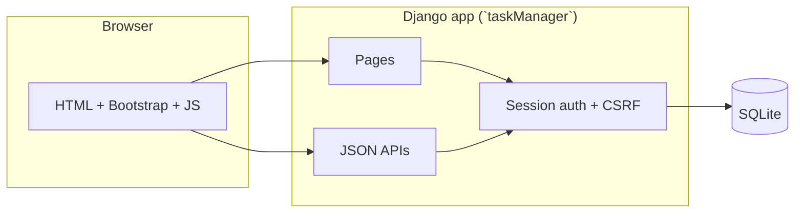

# myTasks

A workspace-based task manager for people who keep both a personal to-do list and shared work with a small team.

You create a workspace, add lists inside it, then add tasks with a due date and a priority. Personal workspaces stay private. Work workspaces let you invite people by username, assign a task to someone, and notify them when they are added.

The product is a browser app. There is no mobile client and no third-party login.

---

## Who it is for

- Students or small teams who want lists grouped by project, not one endless inbox
- Anyone who currently splits “my tasks” and “team tasks” across notes and group chats
- A first place to try role-based access: the creator runs the board, members complete what was assigned to them

---


## What you can do


| Area                   | What you get                                                                                                                                                 |
| ---------------------- | ------------------------------------------------------------------------------------------------------------------------------------------------------------ |
| **Accounts**           | Register and sign in. Signed-in users go straight to workspaces.                                                                                             |
| **Personal workspace** | Only you. Create lists, add tasks, edit, delete, mark complete.                                                                                              |
| **Work workspace**     | Invite registered users by username. They are notified. You assign each task.                                                                                |
| **Lists**              | Several to-do lists inside one workspace, opened from the Lists menu.                                                                                        |
| **Tasks**              | Title, due date, priority (High / Medium / Low). Completed items stay on the list with a strike-through so you can undo them. Overdue open tasks are marked. |
| **Roles**              | Creators add and edit. Members see only tasks assigned to them and can complete those.                                                                       |
| **Notifications**      | A feed when someone adds you to a Work workspace.                                                                                                            |


---


## How a typical journey works

```text
Create an account
    → Create a Personal workspace, or a Work workspace and invite usernames
        → Add a list
            → Add tasks (assign them if it is a Work workspace)
                → Open the list, complete or edit items
                    → Members get a notification and see only their assignments
```

---


## Architecture




```text
Browser  →  Django (PORT, default 8002 in this checkout)
                →  SQLite (db.sqlite3)
                →  Session cookie + CSRF token
```

**Pages.** Landing (sign in / register), create workspace, workspace board, notifications.

**APIs.** Lists, tasks, completion, sidebar workspace list. All mutating calls require a signed-in session and a CSRF token. Workspace IDs are checked against membership before anything is returned.

The Django project package is still named `finalProject` (the original college project name). The app you work in is `taskManager`.

---


## Technology


| Layer   | Choice                                     |
| ------- | ------------------------------------------ |
| Website | HTML, CSS, Bootstrap 5, vanilla JavaScript |
| App     | Python 3.10+, Django 4.2                   |
| Store   | SQLite                                     |
| Auth    | Django users and sessions                  |


No paid APIs. No Docker. A virtual environment is enough.

---


## Project layout

```text
MyTasks/
├── manage.py
├── setup.md                 Step-by-step local setup
├── .env.template            Port, debug, secret key
├── finalProject/            Django project settings
├── taskManager/
│   ├── models.py            Users, Workspace, TaskList, Task, Notification
│   ├── views.py             Pages and JSON APIs
│   ├── urls.py
│   ├── templates/taskManager/
│   └── static/taskManager/
└── requirements.txt
```

---


## Getting started

Install, first run, and a working checklist are in **[setup.md](setup.md)**.

The short version:

```bash
cd MyTasks
python3.12 -m venv .venv   # python3 -m venv if that is already 3.10+
source .venv/bin/activate   # Windows: .venv\Scripts\activate

pip install -r requirements.txt
cp .env.template .env
python manage.py migrate
python manage.py runserver 8002
```

Then open [http://localhost:8002](http://localhost:8002).

---

